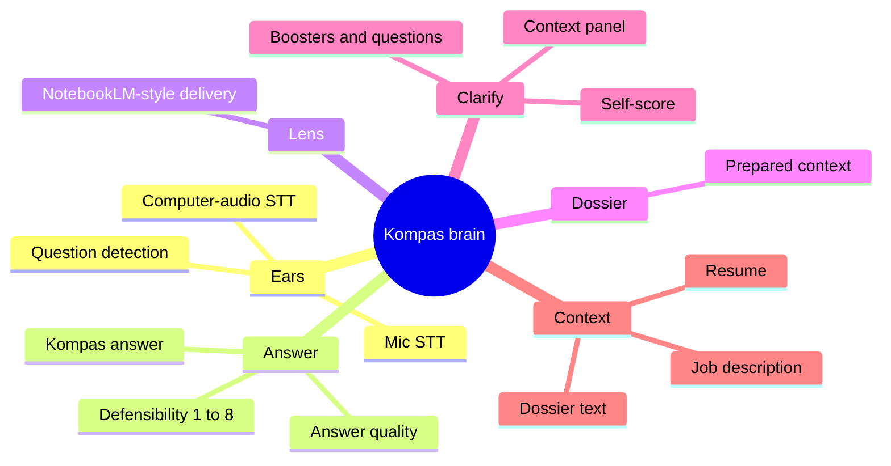
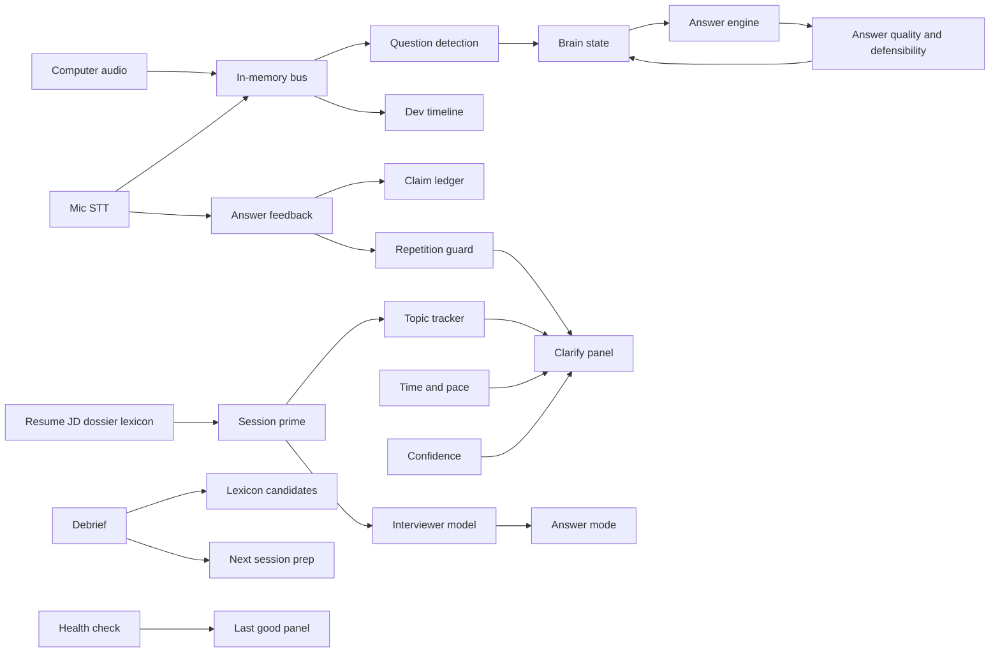

# Kompas brain map

The brain is the in-process hub. Engines publish events and read one shared state: the claims ledger, topics, and the current question. The bus is synchronous memory. It does not poll and it does not call the network. The only model call in the product is still the main answer.

| Module | Inputs | Outputs | Consumers |
|---|---|---|---|
| Session start | Resume, JD, dossier, prior prep | `session.prime` | Topic tracker, interviewer model |
| Topic tracker | Interviewer lines, primed JD topics | `topic.track` | Clarify framing, answer frame |
| Interviewer model | JD, interviewer lines | `interviewer.model` | Answer mode, pace nudge |
| Answer feedback | Mic line, last suggestion | `answer.feedback` | Ledger, repetition guard |
| Repetition guard | Openers already said | `repetition.guard` | Clarify line, answer frame |
| Time awareness | Elapsed time, interviewer words, answer length, pace | `time.pace` | Clarify nudge |
| Confidence | Question, resume, perspective lines | `confidence.flag` | Clarify question, honest "I would" line |
| Post-session debrief | Questions, answers, gaps, unknown JD terms | `session.debrief` | Lexicon candidates, next prep |
| Health | Subscriber errors, pass latency | `health.check` | Degraded flag, last good panel |
| Observability | Every bus event latency | `debug.span` | Dev timeline on the snapshot |

| Event | Who publishes | Who reads it |
|---|---|---|
| `ear.transcript` | Mic and computer-audio lines | Brain perceive loop, question detection, topic tracker, feedback |
| `ear.question` | Question detection | Lens, dossier note, answer request |
| `context.attach` | Resume, JD, dossier already on the request | Session prime |
| `session.prime` | Session prime | Topic tracker, interviewer model |
| `topic.track` | Topic tracker | Clarify framing, answer frame |
| `interviewer.model` | Interviewer model | Answer mode, pace |
| `answer.feedback` | Mic versus the last suggestion | Ledger, repetition guard |
| `repetition.guard` | Repetition guard | Clarify line |
| `time.pace` | Pace check | Clarify nudge |
| `confidence.flag` | Low-evidence answer | Clarify question and the "I would" line |
| `session.debrief` | End of session or a wrap-up | Lexicon candidates, next prep |
| `health.check` | A failed or slow subscriber | Degraded flag; the panel keeps the last good line |
| `debug.span` | Timeline | Dev snapshot only. Hidden when `NODE_ENV` is production |
| `clarify.action` | Brain policy | Context panel |
| `known-terms` | Lexicon match on the line | Answer frame, candidate log |
| `lens.note` | Lens | Brain snapshot |
| `dossier.note` | Dossier text already attached | Brain snapshot |
| `answer.ready` | Answer engine, after the answer exists | Answer quality, confidence |
| `answer.scored` | Quality | Brain snapshot |
| `brain.state` | Brain, after each line | All of the above |

The Windows shell does not host a second copy of this bus. It loads the live web page, and that page runs the same client bus.
