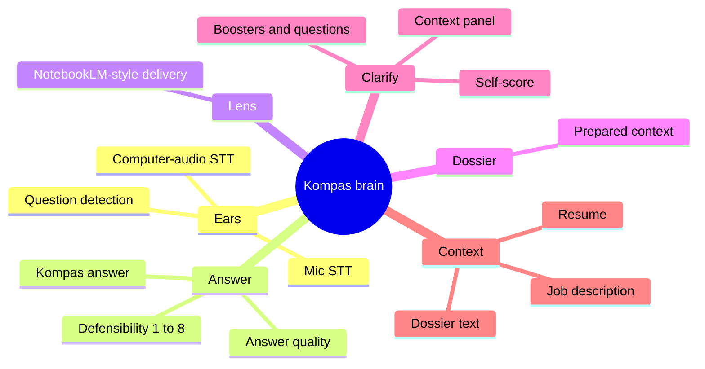
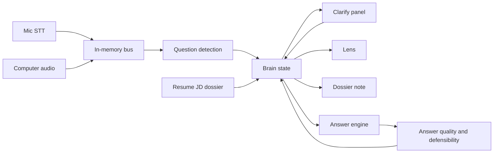

# Kompas brain map

The brain is the in-process hub. Engines publish events and read one shared state: the claims ledger, topics, and the current question. The bus is synchronous memory. It does not poll and it does not call the network. The only model call in the product is still the main answer.

| Event | Who publishes | Who reads it |
|---|---|---|
| `ear.transcript` | Mic and computer-audio lines | Brain perceive loop, question detection |
| `ear.question` | Question detection | Lens, dossier note, answer request |
| `context.attach` | Resume, JD, dossier already on the request | Every subscriber via brain state |
| `clarify.action` | Brain policy | Context panel |
| `lens.note` | Lens | Brain snapshot |
| `dossier.note` | Dossier text already attached | Brain snapshot |
| `answer.ready` | Answer engine, after the answer exists | Answer quality and defensibility |
| `answer.scored` | Quality | Brain snapshot |
| `brain.state` | Brain, after each line | All of the above |

The Windows shell does not host a second copy of this bus. It loads the live web page, and that page runs the same client bus.
